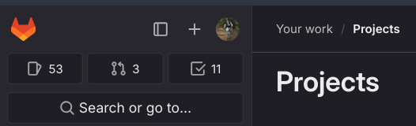
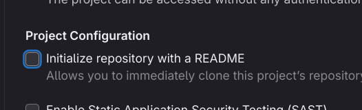

## Why Version Control?

- Maintain history of software development changes.
- Maintain multiple versions of software that are released.
- Tool for code review.
- Audit trail for compliance.
- Required for IEC 62304 (Medical Software), FDA V\&V (510k clearance).
- Collaboration between multiple developers.
- Great skill to have on a resume.

## Why `git`?

- Most popular distributed version control system
- Replaces centralized, single-point systems (e.g., subversion)
- Open-source
- Lightweight

## Why not `git`?

- Learning curve non-trivial, especially for advanced usage
- Doesn't work well with binary (non-text) data
- Doesn't work well with large files (e.g., audio, video) 

## Remotes

## Git Collaboration

- Local version control is very powerful, and if you are the only developer of a project and using a single computer exclusively, all that is necessary.
- But what if you want to collaborate with others / yourself on another system? **Git Remotes!**

## Git Remotes

- A **remote** is another location where your git repository history exists.
- Remotes can be:
  - On your local computer
  - On a networked computer (e.g., server)
  - On a cloud-based service (e.g., GitHub, GitLab, BitBucket)
- When starting a new git repository that will be shared (i.e., will have at least one `remote`), you have a few ways to start things:

1. Create a local git repository and then add a remote.
1. Create a remote git repository and then `clone` it to your local computer.
1. For this class, all of your assignment repositories will need to be shared via GitLab, so I will recommend you create them on GitLab first, and then clone them to your local computer.


```{mermaid}
%%{init: {"theme": "base", "themeVariables": {"primaryColor": "#eef3fb", "primaryBorderColor": "#2d63ba", "primaryTextColor": "#1e1e1e", "lineColor": "#2d63ba", "clusterBkg": "#f7f9fc", "clusterBorder": "#2d63ba", "edgeLabelBackground": "#ffffff"}}}%%
flowchart LR
    subgraph shared["Class Group Space (GitLab)"]
        Central[("Shared Project Repo")]
    end

    subgraph forkspace["Student User Space (GitLab)"]
        Fork[("Forked Repo")]
    end

    LocalA[("Local Clone A")]
    LocalB[("Local Clone B")]
    StudentLocal[("Student Local Clone")]

    LocalA -- "git push (origin)" --> Central
    Central -- "git pull (origin)" --> LocalA

    Central -- "git clone" --> LocalB
    LocalB -- "git push (origin)" --> Central
    Central -- "git pull (origin)" --> LocalB

    Central -- "fork" --> Fork
    Fork -- "git clone" --> StudentLocal
    StudentLocal -- "git push (origin)" --> Fork
    Fork -- "git pull (origin)" --> StudentLocal
    Central -. "git pull (upstream)" .-> StudentLocal
```

## Creating a new repository on GitLab

- Create a new repository on GitLab, named `my_first_git_repo`.

::: callout-warning
Spaces are not allowed in repository names and create problems when working on the commandline, so use underscores or dashes instead.
:::
- `+` icon in the upper left :arrow_right: `New project/repository`



---

- Choose: `Create Blank Project`
- Choose Project Name: `my_first_git_repo`  

::: callout-warning
If this is a new repository that doesn't already exist locally on your laptop,
then you can choose to have GitLab create a `README.md` file; otherwise,
deselect that default option.
:::



- Choose: `Create Project`

## Clone a Repository

- **Cloning** a repository is only done the first time you want to get a copy of your remote repository on your local computer.  (Future interactions with the remote repository will be done via `push` and `pull` commands.)
- You can clone directly using the `Git` tools in VS Code, but I recommend you do it on the commandline so you can see what is happening.
- Below are the steps to clone a repository.
  - For all of this example code, do not replicate the `$`; that indicates that this is a command you would enter in your Terminal or Git Bash session.  
  - Please **CHANGE THE THINGS IN ALL CAPS**.

```sh
$ cd DIRECTORY_WHERE_YOU_WANT_TO_CLONE
$ git clone git@gitlab.oit.duke.edu:YOUR_NET_ID/my_first_git_repo.git
```

## Success will look like:

```sh 
Cloning into 'my_first_git_repo'...
warning: You appear to have cloned an empty repository.
```

- You will not see that warning if you chose to have GitLab create a `README.md` file when you created the repository.

## Initialize a Project Directory (not already on a remote)

- Make sure you are at the root level of your desired project directory (the "main" folder of the project).

```sh
$ git init
```

- A `.git/` directory will be created that stores all version history
- Success will look like:

```sh
Initialized empty Git repository in YOURPROJECTDIR/.git/
```

## Local Workflow

Once you have a local git repository, either through cloning or initializing one, you can start working on your project.  All of the following commands are valid when you are "inside" your project directory (root level or deeper).   You can also execute all of these commands natively within VS Code (and more elegantly with GitLens within VS Code).

## Git Status

```sh
$ git status 
```

- Files that are not tracked ("**untracked**").
- Tracked files that have been **modified** since last committed.
- Files that are **staged** (explicitly added / removed) to be committed.
- Run `git status` frequently to keep track of what you are doing.  VS Code will show you the status "live" in the bottom left corner of the window.

## What does `git` track?

- `git` will only track **files** that you explicitly tell it to track.
- Directories are only tracked if they contain tracked files.
- Untracked files can be added to a queue (staged) to be **committed** to a git history (in a separate step) using:

```sh
$ git add FILENAME(S) 
```

- **Adding** a file **stages** it for **commit**.
- `git stage` is a direct alias for `git add`.  VS Code's GitLens will use the term "stage" instead of "add".

---

- Changes made to tracked files must be explicitly added to the commit queue too.
- Multiple files can be staged together to create a commit that logically should be bundled together. 
  

::: callout-warning
While it is valid syntax to add an entire directory as `git add .` or to use
wildcards to add mutliple files by a common pattern using `git add
*_SOME_PATTERN`, I recommend you explicitly add files one at a time to avoid
accidentally adding files you don't want to track.
:::

## Committing Staged Files

- The following command will commit your staged files.  A commit message is required, which can be entered in the editor that opens when you execute the command, or you can use the `-m` option to enter a one-line commit message on the commandline.

```sh
$ git commit -m 'one line commit message goes between the quotes'
```

- Committing is the process of capturing the specific state of files in the version history.

## Commit Messages

- Need to include a commit message that describes **why** you are making these changes.
- You do not need to describe **what** has changed; that is done automatically by:

```sh
$ git diff FILE_NAME 
```

---

- Here are some examples of what a proper commit message looks like, such that when you perform a `git log`, you thank your past self for knowing what and when you edited.

| Bad Commit Message         | Good Commit Message                                            |
|-----------------------------|----------------------------------------------------------------|
| fixed issue                   | Fixed GND pour on my PCB to ensure DRC checks pass |
| added function              | edited arduino code to user timers instead of sleep  |
| boom     | if you're right at the deadline, this one is understandable |
| updated piece | updated CAD render for H3 neck to be at 75deg angle |

## Git Add/Commit Shortcut

- A common operation is editing files that are already under version control and wanting to commit all of those changed files.
- There is a shortcut to do this quickly:

```sh
$ git commit -am 'commit message' 
```

## Git Log

- You can view a history of your commits:

```sh
$ git log
```

- Note that the first line of your commit message will be displayed in the log output.
- Includes your name and email address, as configured in `.gitconfig`.
- If you setup my `lg` alias, you will see a "prettier" version of the output using `git lg`.

## Can certain files/directories be "ignored"?

- Sometimes we will have files that we never want `git` to manage
- These will always show up as `Untracked` if they are never added.
- We can tell git to ignore these files/directories in a file called `.gitignore`.
  - Create this file at the root of the project.  
  - Be sure to `add` and `commit` it!
- Can use `/` at the end of the name to indicate a directory name.
- Can use `*` as a wildcard to any characters in the name pattern match.
- Certain types of projects will have default templates of files to ignore.

## Example `.gitignore`:

```sh
$ cat .gitignore 
build/*
.idea
.cache
.ipynb_checkpoints
.DS_Store
env/
venv/
.venv/
```

## Live Demo

Live demo time!
>
## More Git Basics 

## How do a undo changes to a file?

- If you have modified a file that was already tracked and want to restore it to the previously-committed version:

```sh
git restore [file] 
```

- You can also revert to previously-committed versions older than the latest commit... but that is a more advanced topic.

## Pushing/Pulling Git Commits

- Once a local repository is connected to a remote, you can:
  - **Push** local commits to the remote (`git push`)
  - **Pull** commits from the remote (`git pull`)

::: callout-important
You will always need to pull the latest commits from a repository before you push anything new.
:::

## More Advanced Git Workflows

## Branching

- By default, your project is working on a branch called `main`.

::: callout-note
Some older versions of `git` used a default name of `master`, but that has been deprecated.*  If your configuration is still using `master`, please consider [changing the default branch name](https://docs.github.com/en/repositories/configuring-branches-and-merges-in-your-repository/managing-branches-in-your-repository/changing-the-default-branch).
:::

- Branches allow you to add/modify files, potentially with multiple commits, but
without changing the files as they exist in `main`.
- Committed changes on your branch can be **merged** into `main` (or another
branch) when they are "ready".

## Steps to Create and Use a Development Branch

```sh
$ git branch BRANCHNAME  # this creates a new branch
$ git checkout BRANCHNAME  # this switches to the branch
```

- If a branch already exists, you can just switch to it using `git checkout`.
- [`git switch`](https://git-scm.com/docs/git-switch) achieves the same behavior when swiching between branches.

::: callout-tip
You can create and checkout a branch using:

```sh
$ git checkout -b BRANCHNAME
 
OR

$ git switch -c BRANCHNAME
``>`
:::

---

## Naming Branches

- It is important to use good branch names! This will be helpful for you when breaking up your tasks, and knowing what you should focus on developing in the specified branch. 
- There isn't a **best** practice for naming branches, but consider using the template: `functionality-in-my-project`. 
- For example, if you are developing a library to calculate heart rate from an ECG signal, a good branch name would be `dev-calc-ecg-hr`.

## Branches on Remotes

- You can push a branch to your remote just like you would `main`.
- Git may prompt you to have to create the branch on `origin` with the same name as the local branch:

```sh
$ git push --set-upstream origin BRANCHNAME
```

- If you want to avoid having to manually set the upstream branch, you can set a configuration option to always do that for you.  You probably set this up in the first week of class in your `.gitconfig` file, but if not:

```sh
$ git config --global push.autoSetupRemote true
```

## Merging a Branch

- Once you are "done" developing on a branch, you can `merge` your changes back into your `main` branch (or another branch).
- Merging is also the way that you can incorporate another developer's code into your branches.

```sh
$ git checkout main  # switch to the branch you want to merge into
$ git merge BRANCHNAME  # merge the branch into the current branch
```

## Merging Approaches

- **Merge:** Creates a commit reflecting the merged content, in addition to the individual commits on the branch being merged.
- **Squash:** Create a single merge commit, "squashing" all of the commits of the feature branch into one commit.
- **Rebase:** Integrate the commits of the feature branch into your target branch by "replaying" them into the history.
  - This can be the trickiest approach to use and can cause major headaches if you have already pushed commits to a remote.  
  - Probably best to avoid as you get familiar with merging.

## Pull/Merge Requests

- You can also use the UI of GitHub/GitLab to merge one branch into another.
- These "requests" can allow you to:
  - Review the differences between the branches.
  - Provide feedback to developers before merging.

## [Annotated] Tags

- `Tags` are simply meaningful "names" to associate with specific git commits.
- Typically associated with some milestone / release.
- **Annotated tags** are usually used to tags a [semantic version number](https://semver.org/)--along with a message--to a specific commit.
- Example syntax to create a tag for the current commit checked out:

```sh
$ git tag -a 'v1.0.0' -m 'version of code for submission'
```

- Example syntax to create a tag for a specified commit:

```sh
$ git tag -a 'v1.0.0' -m 'version of code for submission' COMMIT_HASH
```

---

- Locally-created tags have to be specifically pushed to remotes using:

```sh
$ git push --tags
```

- You can see what tags exist locally using:

```sh
$ git tag --list
```

- Tags are available via the GitLab/GitHub web UI (and can be used to create Releases).

## Issues

- Issues are used via the web UI to report bugs, request features, ask questions, etc.
- We will use Issues as the primary way to ask the TAs / Dr. Palmeri questions (you will need to add collaborators explicitly to your Private projects).
- Commits related to issues can automatically trigger action (e.g., closing, fixing) using certain commit message [keywords](https://docs.gitlab.com/ee/user/project/issues/managing_issues.html#default-closing-pattern). 

## Miscellaneous Topics

## Add a Remote

- You can add a remote using the following syntax:

```sh
$ git remote add origin git@gitlab.oit.duke.edu:YOUR_NET_ID/YOUR_PROJECT_NAME.git
```

- You can access the URL for a remote repository after you create it online.
- The default remote name is `origin`.  That name is arbitrary, but widely used.
- You can have multiple remotes associated with a repository.
- URLs that start with `git@` use SSH keys to authenticate you.
- You can see the remotes associated with your local git repository as follows:

```sh
$ git remote -v
origin  git@gitlab.oit.duke.edu:YOUR_NET_ID/YOUR_PROJECT_NAME.git (fetch)
origin  git@gitlab.oit.duke.edu:YOUR_NET_ID/YOUR_PROJECT_NAME.git (push)
```

## Git Team Workflow

```{mermaid}
%%{init: {"theme": "base", "themeVariables": {"primaryColor": "#eef3fb", "primaryBorderColor": "#2d63ba", "primaryTextColor": "#1e1e1e", "lineColor": "#2d63ba", "edgeLabelBackground": "#ffffff"}}}%%
flowchart TB
    accTitle: Two students sharing one GitLab repository
    accDescr: Student A forks the instructor's repository and adds Student B as a Developer to that project. Both students clone Student A's repository to their own local machines and use it as origin.
    Upstream["Instructor's parent repository"]
    AFork["Student A's fork (GitLab)<br/>Shared team repository"]
    ALocal["Student A's local clone"]
    BLocal["Student B's local clone"]

    Upstream -->|"Student A forks"| AFork
    AFork -->|"A clones"| ALocal
    AFork -->|"A adds B as Developer; B clones"| BLocal
```

- Student A adds Student B as a project member with the **Developer** role before B clones A's repository.
- Both students use `origin` for **A's shared repository** and `upstream` for the **instructor's repository**.
- Cloning configures `origin`; each student adds `upstream` in their local clone with `git remote add upstream INSTRUCTOR_REPO_URL`.

## Git Team Workflow: Local Development

Each student works in **their own local clone of A's repository**, using the shared `single-sample-adc` development branch.

```{mermaid}
%%{init: {"theme": "base", "themeVariables": {"primaryColor": "#eef3fb", "primaryBorderColor": "#2d63ba", "primaryTextColor": "#1e1e1e", "lineColor": "#2d63ba", "edgeLabelBackground": "#ffffff"}}}%%
flowchart LR
    accTitle: Local development branches for each student
    accDescr: Student A creates and publishes single-sample-adc from main, and Student B clones that published branch. In their own local clones, students create task sub-branches such as adc-config and adc-tests from single-sample-adc and merge their sub-branches locally back into single-sample-adc before sharing changes.
    Main["main"]
    Dev["single-sample-adc"]
    FeatureA["adc-config<br/>work and commit"]
    FeatureB["adc-tests<br/>work and commit"]
    Integrated["single-sample-adc<br/>combined local work"]

    Main -->|"A creates and publishes;<br/>B clones branch"| Dev
    Dev -->|"create sub-branch"| FeatureA
    Dev -->|"create sub-branch"| FeatureB
    FeatureA -->|"merge locally"| Integrated
    FeatureB -->|"merge locally"| Integrated
```

- `adc-config` and `adc-tests` both branch from `single-sample-adc`.
- To integrate a sub-branch, switch back to `single-sample-adc` and run `git merge BRANCH_NAME`; resolve any conflicts and test locally.
- The two `single-sample-adc` boxes show the **same branch before and after** the local merges.
- Initially, Student A publishes `single-sample-adc` with `git push -u origin single-sample-adc` so Student B can clone that branch.

## Git Team Workflow: Share with Your Teammate

Example: **Both students work in Student A's repository**, starting on A's local `single-sample-adc` branch.

- A adds B as a project member in GitLab with the **Developer** role.
- B clones **A's repository**; both students use that repository as `origin`.

```{mermaid}
%%{init: {"theme": "base", "themeVariables": {"primaryColor": "#eef3fb", "primaryBorderColor": "#2d63ba", "primaryTextColor": "#1e1e1e", "lineColor": "#2d63ba", "edgeLabelBackground": "#ffffff"}}}%%
sequenceDiagram
    accTitle: Share Student A's development work with Student B
    accDescr: A adds B as a Developer to A's GitLab repository and publishes single-sample-adc. B clones that branch from A's repository, commits local work, pulls shared changes, resolves conflicts and tests, then pushes to the same branch. Both students repeat this cycle. When development is complete, they open a Merge Request into main for review.
    participant A as Student A (local)
    participant Repo as A's repository (GitLab)
    participant B as Student B (local)

    Note over A,B: B has Developer access to A's repository
    A->>Repo: 1. git push -u origin single-sample-adc
    B->>Repo: 2. git clone -b single-sample-adc A_REPO_URL
    Repo-->>B: Local clone of A's repository
    B->>B: 3. Edit, git add, git commit
    B->>Repo: 4. git pull --no-rebase origin single-sample-adc
    Repo-->>B: Teammate's published commits
    B->>B: Resolve conflicts,<br/>complete merge, test
    B->>Repo: 5. git push origin single-sample-adc
    Note over A,B: Both students repeat steps 3–5 on single-sample-adc
    Repo->>Repo: 6. When development is complete:<br/>MR single-sample-adc → main<br/>Review and merge
```

- Replace `A_REPO_URL` with A's GitLab clone URL; B then enters the cloned directory.
- Commit before pulling; resolve any conflicts and test before pushing. If a push is rejected because the branch advanced, repeat steps 4–5.
- Open a Merge Request from `single-sample-adc` into `main` in A's repository only when the feature is complete.

## Cherry-pick an Upstream Update

:::: {.columns}
::: {.column width="65%"}

```{mermaid}
%%{init: {"theme": "base", "flowchart": {"nodeSpacing": 20, "rankSpacing": 20, "padding": 8}, "themeVariables": {"primaryColor": "#eef3fb", "primaryBorderColor": "#2d63ba", "primaryTextColor": "#1e1e1e", "lineColor": "#2d63ba", "edgeLabelBackground": "#ffffff"}}}%%
flowchart TB
    accTitle: Apply one instructor commit to a student's fork
    accDescr: From a clean local branch, fetch the instructor's upstream repository, cherry-pick the selected commit, resolve and stage any conflicts and continue, inspect the resulting commit and status, then push the current branch to the student's own fork. Fetching does not change working files; cherry-picking creates a new commit with its own hash.
    Upstream[("Instructor's repository<br/>upstream")]
    Fork[("Your GitLab fork<br/>origin")]

    Fetch["1. In your local clone:<br/>git fetch upstream"]
    Pick["2. On your current branch:<br/>git cherry-pick COMMIT_HASH"]
    Resolve["Resolve conflicts<br/>git add RESOLVED_FILE<br/>git cherry-pick --continue"]
    Verify["3. Verify changes<br/>git show HEAD<br/>git status"]

    Upstream --> Fetch
    Fetch --> Pick
    Pick -->|"success"| Verify
    Pick -->|"conflicts"| Resolve
    Resolve --> Verify
    Verify -->|"4. git push origin HEAD"| Fork

    classDef step fill:#eef3fb,stroke:#2d63ba,color:#1e1e1e
    class Upstream,Fetch,Pick,Resolve,Verify,Fork step
```

:::
::: {.column width="35%"}
::: {style="font-size: 0.75em;"}

- Start on your target branch with a **clean working tree** (commit or stash changes).
- `origin`: **your fork**. `upstream`: **instructor's repository**.
- Fetch leaves working files unchanged. Cherry-pick applies **one commit's changes**, creating a **new commit with a new hash**.
- Use the instructor's `COMMIT_HASH`; stage each `RESOLVED_FILE` after resolving conflicts.
- To cancel after conflicts: `git cherry-pick --abort`.
:::
:::
::::
